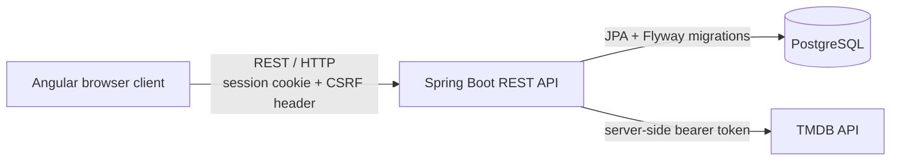

# 🎬 END CREDITS

### For the films that stayed.

End Credits is a cinema identity and social discovery platform for people who
want to keep a more personal record of the films they watch. It brings together
movie discovery, watch tracking, private or public cinema profiles, short
written Takes, and a deliberately cinematic interface.

> **Status:** 🚧 Active Development

The project is currently a full-stack modular monolith: an Angular client, a
Spring Boot API, PostgreSQL persistence, and server-side TMDB integration.

## Product preview

There are no product screenshots checked into this repository yet. Planned
captures for this section:

- Home / For You
- Discover
- Movie Detail
- Private and public Profile
- Mobile view

## Why End Credits?

Movie apps often reduce a film to a rating or an endless catalogue. End Credits
is designed around what remains after watching: a personal cinema identity, the
films worth returning to, and the words a film leaves behind.

## Current features

- Account registration, sign-in, sign-out, and persisted session recovery.
- TMDB-backed movie search, genre/browse shelves, details, cast, director, and
  related-film discovery.
- A personal collection with **Watchlist**, **Watching**, and **Finished**
  states, rewatch events, removal, and optional 1–10 ratings.
- **My Five**: up to five saved films that define a member's cinema identity.
- Movie-first **Takes**: one editable written response per saved film.
- Opt-in public cinema profiles that project selected collection information,
  My Five, ratings, statuses, and Takes without exposing private accounts.
- A responsive cinematic UI across the admission screen, Home, Discover,
  Movie Detail, and profile experiences.
- A transparent Vibe interaction that maps moods to fixed TMDB genre shelves;
  it is not presented as a machine-learning recommendation engine.

## Tech stack

| Layer | Current implementation |
| --- | --- |
| Frontend | Angular 22, TypeScript, RxJS |
| Backend | Java 25, Spring Boot 4.1, Spring MVC, Spring Data JPA, Spring Security |
| Database | PostgreSQL, Hibernate, Flyway |
| External movie data | TMDB API, called only by the backend |
| Build tools | npm / Angular CLI and Maven Wrapper |

## Architecture



TMDB credentials stay on the server. The browser calls the End Credits API; it
never receives the TMDB read-access token directly.

## Engineering highlights

- **Clear full-stack boundary:** Angular owns presentation and client-side
  interaction; Spring Boot owns authentication, authorization, persistence,
  validation, and external API access.
- **Session security for an SPA:** Spring Security uses a server-side session
  context with session-ID rotation on login, explicit logout, and CSRF
  protection. The Angular interceptor sends credentials and the CSRF header for
  state-changing requests.
- **Secret-aware configuration:** database settings and the TMDB token are read
  from environment variables rather than source code.
- **Repeatable database evolution:** Flyway migrations establish and evolve the
  schema while Hibernate validates it at startup.
- **Privacy by default:** profiles start private. A non-public or missing public
  profile receives the same not-found result, avoiding account-existence leaks.
- **Persistent movie identity:** saved movie records use TMDB identifiers while
  user-owned data—status, ratings, My Five, watch events, and Takes—lives in
  PostgreSQL.

## Data model

| Table | Purpose |
| --- | --- |
| `users` | Account identity, password hash, creation time, and profile visibility |
| `user_movies` | A user's saved TMDB films, status, poster metadata, and optional rating |
| `watch_history` | Watch and rewatch events for a saved movie |
| `my_five_movies` | Ordered slots for a member's five defining films |
| `movie_takes` | One written Take per user and saved movie |

The schema is created through seven versioned Flyway migrations in
`backend/end-credits-api/src/main/resources/db/migration/`.

## Selected REST API endpoints

### Public

| Method | Endpoint | Purpose |
| --- | --- | --- |
| `GET` | `/api/auth/csrf` | Establishes the CSRF token used by the SPA |
| `POST` | `/api/auth/register` | Creates an account |
| `POST` | `/api/auth/login` | Starts an authenticated session |
| `GET` | `/api/movies/search?query=` | Searches TMDB movie metadata through the API |
| `GET` | `/api/movies/browse/{shelf}` | Returns an allowlisted browse shelf |
| `GET` | `/api/movies/{tmdbId}` | Returns movie detail data |
| `GET` | `/api/movies/{tmdbId}/recommendations` | Returns related movies from TMDB |
| `GET` | `/api/public/profiles/{username}` | Reads an opted-in public cinema profile |

### Authenticated session required

| Method | Endpoint | Purpose |
| --- | --- | --- |
| `GET` | `/api/auth/me` | Returns the current member |
| `POST` | `/api/auth/logout` | Ends the current session |
| `GET`, `POST` | `/api/collection` | Reads or adds collection movies |
| `POST` | `/api/collection/{tmdbId}/status` | Updates a movie's watch status |
| `PUT`, `DELETE` | `/api/collection/{tmdbId}/rating` | Sets or clears a 1–10 rating |
| `DELETE` | `/api/collection/{tmdbId}` | Removes a saved movie |
| `POST` | `/api/collection/{tmdbId}/watch-events` | Records a watch or rewatch event |
| `GET`, `PUT` | `/api/profile/my-five` | Reads or updates My Five |
| `GET`, `PUT` | `/api/profile/visibility` | Reads or changes public-profile visibility |
| `GET` | `/api/takes` | Returns the member's Takes |
| `PUT`, `DELETE` | `/api/takes/{tmdbId}` | Writes or removes a Take |

## Security

- Passwords are stored through Spring Security's delegating `PasswordEncoder`.
- Spring Security stores authenticated state in the server-side HTTP session.
- CSRF protection uses a cookie-backed token and the `X-XSRF-TOKEN` request
  header for unsafe HTTP methods.
- CORS is deliberately restricted to the local Angular development origin
  (`http://localhost:4200`) with credentials enabled.
- The TMDB read-access token, database URL, database username, and database
  password are environment-based configuration—not committed values.

## Roadmap

### ✅ Implemented

- Secure account flow and session-backed authentication
- TMDB movie discovery and detail views
- Watch tracking, rewatch history, and ratings
- My Five, Takes, and public/private cinema profiles
- Responsive cinematic product UI

### 🚧 In progress

- Continued product, interaction, and visual refinement
- Broader automated test coverage and portfolio hardening

### ○ Planned

- Movie Moodboard and Movie Passport
- Taste Match and richer discovery paths
- Movie Night, Movie Letters, Circles, and Release Rooms
- A more advanced Vibe Search and Beyond the Credits experiences
- Yearly End Credits summaries

## Planned architecture

The current modular monolith is intentional. Additional infrastructure will be
introduced only when a concrete product need justifies it. The following are
not implemented in this repository today:

- Redis caching
- Kafka or other asynchronous event infrastructure
- WebSockets
- A FastAPI/Python recommendation service
- Embeddings, pgvector, ML recommendation models, or LLM integration
- Docker, CI/CD, and observability tooling

## Running locally

### Prerequisites

- Node.js and npm
- Java 25
- PostgreSQL
- A TMDB API read-access token

### 1. Configure environment variables

Provide these variables in your shell or operating-system environment before
starting the backend:

```text
END_CREDITS_DB_URL
END_CREDITS_DB_USERNAME
END_CREDITS_DB_PASSWORD
TMDB_API_READ_TOKEN
```

Do not commit their values. Flyway applies pending migrations when the backend
starts.

### 2. Start the backend

Windows PowerShell:

```powershell
cd backend\end-credits-api
.\mvnw.cmd test
.\mvnw.cmd spring-boot:run
```

macOS/Linux:

```bash
cd backend/end-credits-api
./mvnw test
./mvnw spring-boot:run
```

The API runs on `http://localhost:8080` by default.

### 3. Start the frontend

```bash
cd frontend
npm ci
npm start
```

Open `http://localhost:4200`. To verify a production bundle, run:

```bash
npm run build
```

## Project structure

```text
end-credits/
├── backend/
│   └── end-credits-api/       # Spring Boot API, Flyway migrations, tests
├── frontend/                  # Angular application and tests
├── docs/                      # Product direction and engineering decisions
├── .gitignore                 # Public-repository safety rules
└── README.md
```

## Project status

End Credits is actively developed as a portfolio-quality full-stack project.
The repository contains the implemented modular-monolith application; its
planned distributed services and deployment tooling remain intentionally out of
scope for the current stage.

## Author

Yashasvi Dasari
